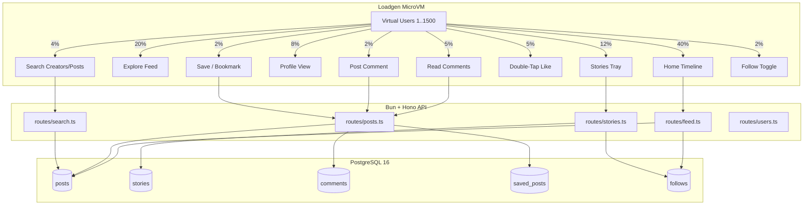

# Implementation Plan: Expanded Realistic Instagram User Interactions Benchmark

## Goal Description
Expand the InstaCloud social media prototype and distributed load generator (`loadgen`) beyond basic feeds and likes to encompass a comprehensive set of real-world mobile interactions:
1. **Comments Engine (Read & Write)**: Paginated post comments and atomic `comments_count` transactions.
2. **Ephemeral Stories Tray**: 24-hour time-bounded active stories from followed creators.
3. **Explore Search**: Prefix and keyword search across creators and captions.
4. **Saved Posts / Bookmarks**: Private collection toggle and personalized saved feed.

This will test additional database access patterns (time-window filters, write contention on hot posts, search index scans, and composite foreign key joins) under high-concurrency simulation (up to 1,500+ virtual users).

---

## User Review Required

> [!IMPORTANT]
> **Database Schema Changes**:
> Adding `stories` and `saved_posts` tables will require executing migrations against the managed PostgreSQL database (`bun run migrate`). Existing tables (`users`, `posts`, `likes`, `follows`, `comments`) and data remain 100% intact.

> [!NOTE]
> **Load Generator Journey Calibration**:
> The simulated journey distribution will be re-balanced from 5 actions to 9 distinct actions to closely emulate genuine mobile session behavior while maintaining high throughput.

---

## Open Questions

> [!TIP]
> 1. **Stories Seed Data**: Should we pre-seed ~5,000 active stories across the top 200 influencers so the stories tray returns rich data immediately?
> 2. **Search Implementation**: For the benchmark, would you prefer standard indexed `ILIKE` / `pg_trgm` queries or full-text `to_tsvector` search? (We propose trigram/prefix index `ILIKE` for low overhead and realistic latency).

---

## Proposed Changes



---

### Database Layer (`scripts/`)

#### [MODIFY] [scripts/migrate.ts](file:///c:/Users/Asad/Desktop/Desktop/Business/instacloud/scripts/migrate.ts)
* Add `stories` table:
  ```sql
  CREATE TABLE IF NOT EXISTS stories (
    id SERIAL PRIMARY KEY,
    user_id INTEGER NOT NULL REFERENCES users(id) ON DELETE CASCADE,
    media_url TEXT NOT NULL,
    created_at TIMESTAMPTZ NOT NULL DEFAULT NOW(),
    expires_at TIMESTAMPTZ NOT NULL DEFAULT NOW() + INTERVAL '24 hours'
  );
  CREATE INDEX IF NOT EXISTS idx_stories_user_expires ON stories (user_id, expires_at DESC);
  ```
* Add `saved_posts` table:
  ```sql
  CREATE TABLE IF NOT EXISTS saved_posts (
    user_id INTEGER NOT NULL REFERENCES users(id) ON DELETE CASCADE,
    post_id INTEGER NOT NULL REFERENCES posts(id) ON DELETE CASCADE,
    created_at TIMESTAMPTZ NOT NULL DEFAULT NOW(),
    PRIMARY KEY (user_id, post_id)
  );
  CREATE INDEX IF NOT EXISTS idx_saved_posts_user ON saved_posts (user_id, created_at DESC);
  ```
* Add search index on `posts(caption)` and `users(username)`:
  ```sql
  CREATE INDEX IF NOT EXISTS idx_posts_caption ON posts USING gin (to_tsvector('english', caption));
  ```

#### [MODIFY] [scripts/seed.ts](file:///c:/Users/Asad/Desktop/Desktop/Business/instacloud/scripts/seed.ts)
* Populate ~25,000 sample comments across posts and sync `comments_count`.
* Populate ~2,500 active stories for top 100 creators expiring in future (+12h to +24h).

---

### API Server (`src/`)

#### [MODIFY] [src/routes/posts.ts](file:///c:/Users/Asad/Desktop/Desktop/Business/instacloud/src/routes/posts.ts)
* Add `GET /:id/comments?cursor=<id>&limit=20` (cursor-paginated comments with author metadata).
* Add `POST /:id/comments` (transaction inserting comment and incrementing `posts.comments_count`).
* Add `POST /:id/save` (toggle bookmark on post for authenticated user).

#### [NEW] [src/routes/stories.ts](file:///c:/Users/Asad/Desktop/Desktop/Business/instacloud/src/routes/stories.ts)
* `GET /tray?userId=<id>`: Returns recent stories from creators the user follows where `expires_at > NOW()`.
* `POST /`: Creates a story for the authenticated user (`media_url`, expires in 24h).

#### [NEW] [src/routes/search.ts](file:///c:/Users/Asad/Desktop/Desktop/Business/instacloud/src/routes/search.ts)
* `GET /?q=<term>&type=users|posts|all`: Fast discovery search querying creators and top matching posts.

#### [MODIFY] [src/routes/users.ts](file:///c:/Users/Asad/Desktop/Desktop/Business/instacloud/src/routes/users.ts)
* Add `GET /:id/saved`: Authenticated endpoint returning user's saved/bookmarked photo grid.

#### [MODIFY] [src/index.ts](file:///c:/Users/Asad/Desktop/Desktop/Business/instacloud/src/index.ts)
* Mount `/api/stories` and `/api/search` sub-routers.
* Update service directory `/` output with the new endpoints.

---

### Load Generator (`loadgen/`)

#### [MODIFY] [loadgen/journey.ts](file:///c:/Users/Asad/Desktop/Desktop/Business/instacloud/loadgen/journey.ts)
Update virtual user probability distribution:
* **40% Home Feed Scroll** (`/api/feed/home`)
* **20% Explore Discovery** (`/api/feed/explore`)
* **12% Stories Tray Fetch** (`/api/stories/tray`)
* **8% Profile & 12-Photo Grid View** (`/api/users/:id`)
* **5% Read Post Comments** (`/api/posts/:id/comments`)
* **2% Write Comment** (`/api/posts/:id/comments`)
* **5% Double-Tap Like** (`/api/posts/:id/like`)
* **4% Search Discovery** (`/api/search?q=<sampleQuery>`)
* **2% Save / Bookmark Post** (`/api/posts/:id/save`)
* **2% Follow / Unfollow Creator** (`/api/users/:id/follow`)

#### [MODIFY] [loadgen/metrics.ts](file:///c:/Users/Asad/Desktop/Desktop/Business/instacloud/loadgen/metrics.ts)
* Expand `actionStats` keys to track:
  * `homeTimeline`, `exploreFeed`, `storiesTray`, `profileView`, `readComments`, `writeComment`, `likePost`, `searchQuery`, `savePost`, `followCreator`.

---

### Documentation & Verification (`scripts/`, `README.md`)

#### [MODIFY] [scripts/test-endpoints.ts](file:///c:/Users/Asad/Desktop/Desktop/Business/instacloud/scripts/test-endpoints.ts)
* Add smoke tests for `stories/tray`, `posts/:id/comments`, `posts/:id/save`, `users/:id/saved`, and `search`.

#### [MODIFY] [README.md](file:///c:/Users/Asad/Desktop/Desktop/Business/instacloud/README.md)
* Update API endpoints table and benchmark action breakdown documentation.

---

## Verification Plan

### Automated Tests
1. **TypeScript Typecheck**:
   ```bash
   bun run typecheck
   ```
2. **Oxlint Fast Linter**:
   ```bash
   bun run lint
   ```
3. **Local/Live Endpoint Smoke Tests**:
   ```bash
   bun run test:endpoints
   ```
4. **Deploy & Live Simulation Smoke Test**:
   ```bash
   bunx insta deploy . --group api --port 3000
   bunx insta deploy ./loadgen --group loadgen --port 8080
   curl -s "https://prod-main-loadgen-e58fbb-00gzy05gj85.compute.instacloud-edge.com/run?users=50&duration=10&rampUpSec=2&thinkTimeMs=200"
   ```

### Manual Verification
* Inspect the returned JSON from `/run` to confirm all 9 actions are populated in `workloadBreakdown` with 100% success rate and expected latency percentiles.
